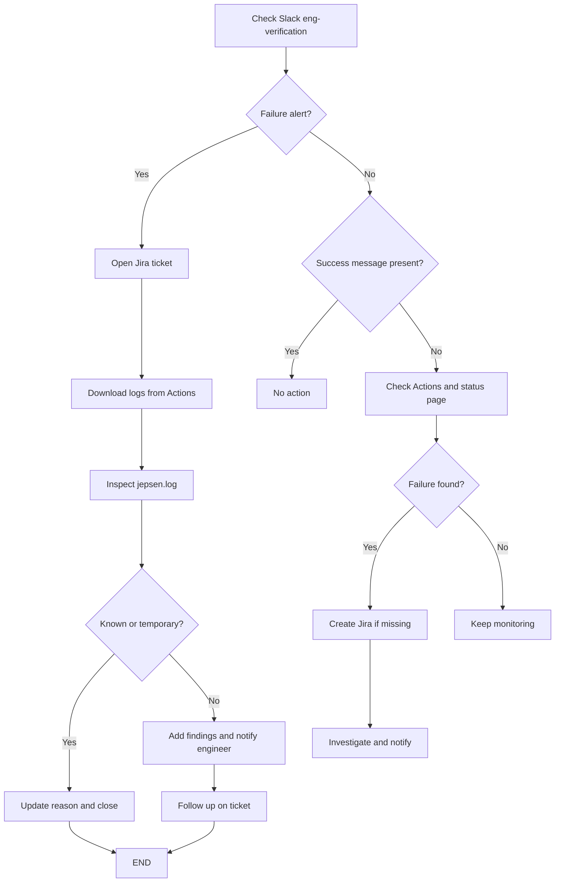

# Daily Test Monitoring & Failure Handling SOP

Quick daily checklist for Jepsen tests in this repository.

| Related docs | |
|--------------|---|
| Environments / how tests run | [test-environment-and-setup.md](./test-environment-and-setup.md) |
| Kelpie verification & benchmarks | [kelpie-test daily SOP](https://github.com/scalar-labs/kelpie-test/blob/master/docs/daily-test-checks.md) |

**What this repo covers:** daily Jepsen for ScalarDB, ScalarDL, and ScalarDB Cluster.  
**What kelpie-test covers:** Kelpie verification and benchmarks.

---

## 1. Daily Monitoring

1. Check Slack channel **`eng-verification`** for the three daily summaries (Cluster, ScalarDL, ScalarDB).
2. If Slack is quiet (no success and no failure), or something looks incomplete:
   * Open [GitHub Actions](https://github.com/scalar-labs/scalar-jepsen/actions)
   * Open the [status page](https://scalar-labs.github.io/scalar-jepsen/) (updated after each daily finishes; ~30-day history)

**When do the dailies run?** Sunday–Friday only (no Saturday). Times below are cron UTC and approx IST:

| Workflow | Cron (UTC) | Approx IST |
|----------|------------|------------|
| Daily ScalarDB Cluster test | `0 10 * * 0-5` | 15:30 |
| Daily ScalarDL test | `0 14 * * 0-5` | 19:30 |
| Daily ScalarDB test | `0 15 * * 0-5` | 20:30 |

Each run uses a temporary GitHub-hosted runner. There is nothing to SSH into or destroy in Azure after the job ends.

> **Note:** AI triage labels in Slack/Jira are currently unreliable or missing. Always use Actions artifacts (`logs-*`) — see [§4 AI triage](#4-ai-triage-currently-not-working).

---

## 2. Failure Handling (Slack Alert Present)

1. Open the **Jira** ticket (project **`DLT`**). It should contain the Actions run URL and commit. Artifact names are usually `logs-<test>` and (if present) `triage-<test>`.
2. Open the Actions run and download **`logs-<test>`**. Inside the Jepsen store, start with `current/jepsen.log`. Also check `result-<test>` (`success` / `failure` / `timeout`).
3. Update the ticket:
   * **Known / temporary** (infra, timeout, missing log, known flake) → write the reason → close the ticket.
   * **New / real inconsistency** → add findings from the log → notify the right engineer(s) → suggest a fix if you have one → wait for confirmation before acting on a proposed fix.
4. Follow up on the ticket until resolved.

Do not rely on an AI triage label to decide known vs new. Confirm from `jepsen.log`.

---

## 3. Failure Handling (No Slack Alert / No Ticket)

Use this path when Actions shows a failure but Slack/Jira did not fire (or the job died before the test step):

1. Open the Actions run and find the failing job (often compose/Kind/build before the test).
2. Create a Jira ticket in **`DLT`** with the run URL and what you found.
3. Download artifacts if they exist; otherwise use the job log.
4. Notify the relevant engineer(s) and follow up.

Slack/Jira steps are marked `continue-on-error` in the workflow, so a green “Notify Slack” job does **not** mean all tests passed. Always check the matrix jobs and `result-*` artifacts.

---

## 4. AI triage (currently not working)

Daily workflows still call [`.github/scripts/triage.py`](../.github/scripts/triage.py) on failure. That script was meant to read the end of `jepsen.log` and attach a first-pass label.

### Current status

**AI triage is currently not working.** It uses GitHub Models with model id `openai/gpt-4o-mini`, which is no longer available. In practice you will often see:

* No `triage-<test>` artifact
* A failed “First-pass triage with GitHub Models” step (the workflow continues anyway)
* No triage label in Slack / incomplete triage text in Jira

**What to do today:** ignore missing or wrong triage. Investigate with `logs-<test>` / `jepsen.log` as usual. Do not wait for triage to succeed.

**Follow-up (maintainers):** replace the model (or the triage approach) in `triage.py` and update this section when it works again.

### Labels (when triage worked)

| Label | Meaning |
|-------|---------|
| `TEMPORARY_ISSUE` | Likely transient / infrastructure |
| `INCONSISTENCY_REQUIRES_INVESTIGATION` | Credible consistency/correctness signal |
| `UNKNOWN_REQUIRES_HUMAN` | Needs a human look |
| `NO_JEPSEN_LOG` | No `jepsen.log` yet (failed before Jepsen wrote a log) |

Even when triage works again, treat labels as hints only. `"Analysis invalid!"` alone is not proof of a real consistency bug.

---

## 5. Workflow Diagram

---

## 6. More detail

* Environments, schedules, matrices, local reproduce: [test-environment-and-setup.md](./test-environment-and-setup.md)
* Kelpie dailies: [kelpie-test daily SOP](https://github.com/scalar-labs/kelpie-test/blob/master/docs/daily-test-checks.md)
